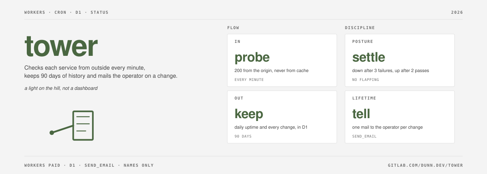

# dunn.dev/tower

tower is a status page that runs on Cloudflare Workers. A prober Worker checks each service from outside every minute, keeps the history in D1 and mails one alert per change. A page Worker renders the status page and `/api/status` through Workers RPC. An optional third Worker, `outside`, mails when `/healthz` stops answering. It needs no server, only a Cloudflare account.

A relay turns an incident.io-format webhook, such as HyperDX's, into one mail per transition.

The design, in figures, is at [tower.dunn.dev/architecture/](https://tower.dunn.dev/architecture/).

Shared as-is: no roadmap, no support promise. Design after [herdr.dev](https://herdr.dev).

## Cloudflare, product by job

| Product | Job |
|---|---|
| Durable Objects, Cron Triggers | an alarm runs due checks each minute, each on its own `every`, and the cron re-arms it; the page's cron watches the prober |
| D1 | check history, state, alert outbox and heartbeats |
| Workers RPC | the page reads status from the prober and asks it to `watch` its last run; no shared storage |
| Sockets | tcp checks |
| 1.1.1.1 DoH | dns checks |
| Certificate packs API | tls checks |
| Email | alert mail through the `send_email` binding |
| Static assets | the page's CSS and favicon |

## Security model

- The page and `/api/status` carry check names, status, uptime and times. They never carry a URL, hostname, address, port or failure reason.
- The page holds no secrets and no storage. The prober is the only owner of D1.
- Failure reasons go only to the alert mail and the Worker log.
- Heartbeat tokens are stored as sha256 hashes; the plaintext never enters your config.
- A check that has not run recently reads as unknown, so a stopped prober cannot leave a stale green page.

Report vulnerabilities as [SECURITY.md](SECURITY.md) describes.

## Instance

An instance is a directory holding `tower.json`, optional `notes/*.md` for maintenance windows and incident write-ups, and optional `theme.css` and `favicon.svg`. [`example/`](example) is a complete one; each field's validation message states its rule. Keep your instance outside this repository. [docs/setup.md](docs/setup.md) covers deploying and running it.

## Limits

- A tcp check against a Cloudflare-proxied address, or one Cloudflare blocks, reads as down with its reason.
- A tcp check is up when the connection opens and down on a connect error or at the timeout. It sends no data, so a service that accepts and then fails reads as up.
- A tls check covers the edge certificates Cloudflare serves. An origin certificate failure shows as http 526.
- Checks run from one Cloudflare location per run. There is no multi-location confirmation, so a failure near that location can read as down.
- Without `outside`, a prober that does not answer mails nothing; `/healthz` reads `unavailable`.
- The outside watcher runs on Cloudflare, so a Cloudflare-wide outage silences it too.
- A maintenance relay keeps only the keys firing now; resolved history is not kept.
- Mail the Email Service refuses as permanent goes dead after 3 tries; a mail still unsent after 24 hours goes dead unless it is a DOWN for a check still down.

## Contributing

Issues and changes are welcome on either forge:

- GitLab (canonical): https://gitlab.com/dunn.dev/tower
- GitHub (mirror): https://github.com/andrewdunndev/tower

GitHub pull requests land through GitLab; the mirror then marks them merged.

See [CONTRIBUTING.md](CONTRIBUTING.md).
